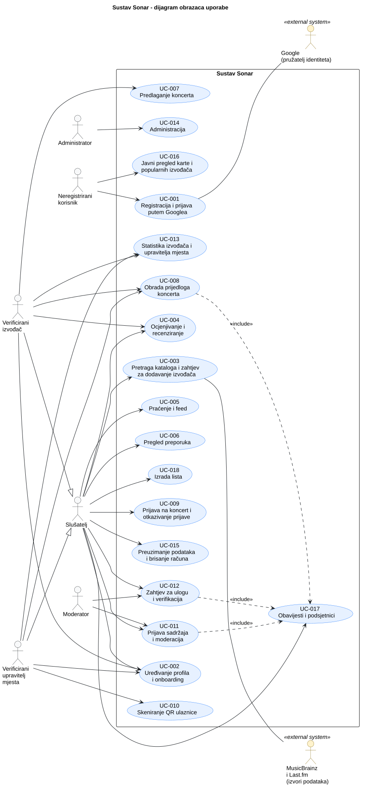

# 3. Obrasci uporabe

## 3.1 Dijagram obrazaca uporabe

Dijagram prikazuje granicu sustava Sonar, aktere i njihove glavne ciljeve. Verificirani izvođač i verificirani upravitelj mjesta imaju sve mogućnosti slušatelja, a Google te MusicBrainz i Last.fm sudjeluju kao vanjski sustavi.

**Slika 3.1. Dijagram obrazaca uporabe sustava Sonar**

**PlantUML izvor:** [izvor](./puml/3-1-sonar-system-UC.puml)

## 3.2 Specifikacije obrazaca uporabe

Svaki obrazac iz dijagrama opisan je tablicom s primarnim akterom, povezanim zahtjevima, preduvjetima, glavnim uspješnim tokom, alternativnim tokovima i posljedicama.

### UC-001: Registracija i prijava putem Googlea

| Element specifikacije | Opis |
| :--- | :--- |
| **Primarni akter** | Neregistrirani posjetitelj (sekundarni akter: Google) |
| **Povezani zahtjevi** | F-002 |
| **Preduvjeti** | Posjetitelj nije prijavljen. Google je dostupan. |
| **Glavni uspješni tok** | TODO: 1. …  2. …  3. … *(nacrt: odabire prijavu, preusmjeravanje na Google, autentikacija i pristanak, povratak u aplikaciju; pri prvoj prijavi nastaje račun s e-poštom od Googlea)* |
| **Alternativni tokovi / Iznimke** | TODO: **[korak]a — [naziv]:** … *(kandidati iz kriterija prihvaćanja: odustajanje od prijave; Google nedostupan; račun suspendiran, deaktiviran ili obrisan se odbija)* |
| **Posljedice (ishod)** | Korisnik je prijavljen (izdan je token). Pri prvoj prijavi nastao je račun. |

### UC-002: Uređivanje profila i onboarding

| Element specifikacije | Opis |
| :--- | :--- |
| **Primarni akter** | Slušatelj (profil izvođača: verificirani izvođač; profil mjesta: verificirani upravitelj mjesta) |
| **Povezani zahtjevi** | F-003 – F-006 |
| **Preduvjeti** | Korisnik je prijavljen. |
| **Glavni uspješni tok** | TODO: 1. …  2. …  3. … *(nacrt: pri prvoj prijavi odabire žanrove i izvođače; uređuje ime ili nadimak, mjesto stanovanja, opis, postavke obavijesti i radijus; izvođač dodaje biografiju, upravitelj unosi kapacitet)* |
| **Alternativni tokovi / Iznimke** | TODO: **[korak]a — [naziv]:** … *(kandidati iz kriterija prihvaćanja: nevaljan unos (prazno ime, nepoznato mjesto); upravitelj ne unese kapacitet pa na mjesto nije moguće predložiti koncert)* |
| **Posljedice (ishod)** | Profil i postavke su spremljeni. Odabir žanrova i izvođača polazište je za preporuke. |

### UC-003: Pretraga kataloga i zahtjev za dodavanje izvođača

| Element specifikacije | Opis |
| :--- | :--- |
| **Primarni akter** | Slušatelj (sekundarni akteri: MusicBrainz i Last.fm) |
| **Povezani zahtjevi** | F-007 – F-010 |
| **Preduvjeti** | Korisnik je prijavljen. |
| **Glavni uspješni tok** | TODO: 1. …  2. …  3. … *(nacrt: upisuje pojam, vidi rezultate, otvara stranicu izvođača, albuma, pjesme ili mjesta; ako izvođača nema, traži dodavanje i izvođač postaje „u obradi“)* |
| **Alternativni tokovi / Iznimke** | TODO: **[korak]a — [naziv]:** … *(kandidati iz kriterija prihvaćanja: nema rezultata; izvođač već postoji (isti MusicBrainz identifikator); dohvat ne uspije nakon ponovnih pokušaja; vanjski servis nedostupan)* |
| **Posljedice (ishod)** | Izvođač je u katalogu sa stanjem „dohvaćen“ ili je zahtjev završio kao „neuspjelo“. |

### UC-004: Ocjenjivanje i recenziranje

| Element specifikacije | Opis |
| :--- | :--- |
| **Primarni akter** | Slušatelj (službeni odgovor: verificirani izvođač) |
| **Povezani zahtjevi** | F-012 – F-014 |
| **Preduvjeti** | Korisnik je prijavljen. Stavka (izvođač, album ili pjesma) postoji u katalogu. |
| **Glavni uspješni tok** | TODO: 1. …  2. …  3. … *(nacrt: otvara stranicu stavke, daje ocjenu 1 do 5 i/ili „sviđa mi se“, piše recenziju; izvođač odgovara na recenziju svojeg izdanja)* |
| **Alternativni tokovi / Iznimke** | TODO: **[korak]a — [naziv]:** … *(kandidati iz kriterija prihvaćanja: ocjena izvan raspona od 1 do 5; prazna recenzija; ponovna ocjena mijenja staru; odgovor na recenziju tuđeg izdanja nije dopušten)* |
| **Posljedice (ishod)** | Ocjena i recenzija su spremljene i vidljive, a interakcija ulazi u preporuke. |

### UC-005: Praćenje i feed

| Element specifikacije | Opis |
| :--- | :--- |
| **Primarni akter** | Slušatelj |
| **Povezani zahtjevi** | F-011, F-016 |
| **Preduvjeti** | Korisnik je prijavljen. |
| **Glavni uspješni tok** | TODO: 1. …  2. …  3. … *(nacrt: prati izvođača ili korisnika; feed prikazuje njihove aktivnosti i novosti)* |
| **Alternativni tokovi / Iznimke** | TODO: **[korak]a — [naziv]:** … *(kandidati iz kriterija prihvaćanja: pokušaj praćenja samog sebe; prestanak praćenja uklanja sadržaj iz feeda; prazan feed)* |
| **Posljedice (ishod)** | Praćenje je spremljeno, a feed prikazuje aktivnosti i novosti praćenih. |

### UC-006: Pregled preporuka

| Element specifikacije | Opis |
| :--- | :--- |
| **Primarni akter** | Slušatelj |
| **Povezani zahtjevi** | F-017 – F-020 |
| **Preduvjeti** | Korisnik je prijavljen. Preporuke su izračunate (novi korisnik polazi od odabira pri registraciji i od popularnosti). |
| **Glavni uspješni tok** | TODO: 1. …  2. …  3. … *(nacrt: otvara preporuke; vidi preporučene izvođače i koncerte, uz svaku razlog („jer voliš izvođača X“))* |
| **Alternativni tokovi / Iznimke** | TODO: **[korak]a — [naziv]:** … *(kandidati iz kriterija prihvaćanja: novi korisnik bez povijesti; preporuke još nisu izračunate)* |
| **Posljedice (ishod)** | Korisnik vidi preporuke s razlogom. Stanje podataka se ne mijenja. |

### UC-007: Predlaganje koncerta

| Element specifikacije | Opis |
| :--- | :--- |
| **Primarni akter** | Verificirani izvođač |
| **Povezani zahtjevi** | F-021 |
| **Preduvjeti** | Korisnik je verificirani izvođač. Mjesto je u katalogu i ima uneseni kapacitet. |
| **Glavni uspješni tok** | TODO: 1. …  2. …  3. … *(nacrt: odabire mjesto, datum i vrijeme, izvođače koji nastupaju i broj mjesta; sustav provjerava i sprema prijedlog* |
| **Alternativni tokovi / Iznimke** | TODO: **[korak]a — [naziv]:** … *(kandidati iz kriterija prihvaćanja: broj mjesta veći od kapaciteta; mjesto bez kapaciteta; nepotpuni podaci; korisnik bez uloge izvođača)* |
| **Posljedice (ishod)** | Koncert je u stanju „predložen“ s rokom za potvrdu. |

### UC-008: Obrada prijedloga koncerta

| Element specifikacije | Opis |
| :--- | :--- |
| **Primarni akter** | Verificirani upravitelj mjesta (otkazivanje: izvođač ili upravitelj mjesta) |
| **Povezani zahtjevi** | F-022, F-023 |
| **Preduvjeti** | Korisnik je verificirani upravitelj mjesta. Postoji prijedlog koncerta za njegovo mjesto. |
| **Glavni uspješni tok** | TODO: 1. …  2. …  3. … *(nacrt: otvara prijedlog i prihvaća ga (koncert postaje potvrđen i otvaraju se prijave) ili odbija uz razlog; potvrđeni koncert može se otkazati)* |
| **Alternativni tokovi / Iznimke** | TODO: **[korak]a — [naziv]:** … *(kandidati iz kriterija prihvaćanja: odbijanje bez razloga nije dopušteno; prijedlog je istekao; prijedlog za tuđe mjesto; otkazivanje obavještava prijavljene)* |
| **Posljedice (ishod)** | Koncert je potvrđen i otvoren za prijave, odbijen, istekao ili otkazan, a zainteresirani su obaviješteni. |

### UC-009: Prijava na koncert i otkazivanje prijave

| Element specifikacije | Opis |
| :--- | :--- |
| **Primarni akter** | Slušatelj |
| **Povezani zahtjevi** | F-024, F-025, F-027 |
| **Preduvjeti** | Korisnik je prijavljen. Koncert je u stanju otvorenih prijava. |
| **Glavni uspješni tok** | TODO: 1. …  2. …  3. … *(nacrt: otvara koncert, odabire prijavu, sustav provjerava slobodna mjesta i izdaje QR ulaznicu; poželjno: dodavanje u kalendar (.ics); otkazivanje najkasnije sat vremena prije početka)* |
| **Alternativni tokovi / Iznimke** | TODO: **[korak]a — [naziv]:** … *(kandidati iz kriterija prihvaćanja: nema slobodnih mjesta; već postoji aktivna prijava; otkazivanje nakon roka; koncert nije u stanju otvorenih prijava)* |
| **Posljedice (ishod)** | Prijava je u stanju „prijavljen“ s QR kodom, a broj slobodnih mjesta je smanjen (pri otkazivanju se vraća). |

### UC-010: Skeniranje QR ulaznice

| Element specifikacije | Opis |
| :--- | :--- |
| **Primarni akter** | Verificirani upravitelj mjesta |
| **Povezani zahtjevi** | F-026, F-028 |
| **Preduvjeti** | Korisnik je verificirani upravitelj mjesta. Slušatelj ima valjanu prijavu za koncert na tom mjestu. |
| **Glavni uspješni tok** | TODO: 1. …  2. …  3. … *(nacrt: skenira QR kod pri ulazu (kamerom mobilnog uređaja); sustav provjerava valjanost i prijavu prebacuje u „došao“)* |
| **Alternativni tokovi / Iznimke** | TODO: **[korak]a — [naziv]:** … *(kandidati iz kriterija prihvaćanja: nevaljan QR; već iskorišten QR; QR za drugi koncert; kamera nedostupna)* |
| **Posljedice (ishod)** | Prijava je „došao“. Prijave koje do kraja koncerta nisu skenirane postaju „nije došao“. |

### UC-011: Prijava sadržaja i moderacija

| Element specifikacije | Opis |
| :--- | :--- |
| **Primarni akter** | Slušatelj (prijava sadržaja) i moderator (obrada prijave) |
| **Povezani zahtjevi** | F-029 – F-032 |
| **Preduvjeti** | Korisnik je prijavljen. Sadržaj (recenzija ili profil) postoji. |
| **Glavni uspješni tok** | TODO: 1. …  2. …  3. … *(nacrt: korisnik prijavljuje sadržaj, prijava je „prijavljeno“; moderator je preuzima („u obradi“), odlučuje o uklanjanju ili odbacivanju uz razlog; radnja ide u zapisnik; sudionici dobivaju obavijest)* |
| **Alternativni tokovi / Iznimke** | TODO: **[korak]a — [naziv]:** … *(kandidati iz kriterija prihvaćanja: moderator ne upiše razlog; prijava odbačena; uklanjanje trećeg sadržaja istog korisnika dovodi do suspenzije)* |
| **Posljedice (ishod)** | Prijava je „uklonjeno“ ili „odbačeno“, radnja je u zapisniku, a po potrebi je korisnik suspendiran. |

### UC-012: Zahtjev za ulogu i verifikacija

| Element specifikacije | Opis |
| :--- | :--- |
| **Primarni akter** | Slušatelj (zahtjev) i moderator (provjera) |
| **Povezani zahtjevi** | F-032 – F-034 |
| **Preduvjeti** | Korisnik je prijavljen. Izvođač ili mjesto postoji u katalogu (ili je zatraženo dodavanje). |
| **Glavni uspješni tok** | TODO: 1. …  2. …  3. … *(nacrt: korisnik odabire izvođača ili mjesto i navodi poveznicu, dobiva jedinstveni kod i objavljuje ga na stranici; moderator provjerava kod i pripadnost stranice te potvrđuje, odbija uz razlog ili traži dopunu)* |
| **Alternativni tokovi / Iznimke** | TODO: **[korak]a — [naziv]:** … *(kandidati iz kriterija prihvaćanja: kod nije vidljiv; stranica ne pripada izvođaču ili mjestu; potrebna dopuna i povratak u provjeru)* |
| **Posljedice (ishod)** | Korisnik je dobio ulogu ili je zahtjev odbijen, a ishod je priopćen obavijesti. |

### UC-013: Statistika izvođača i upravitelja mjesta

| Element specifikacije | Opis |
| :--- | :--- |
| **Primarni akter** | Verificirani izvođač i verificirani upravitelj mjesta |
| **Povezani zahtjevi** | F-039 – F-041 |
| **Preduvjeti** | Korisnik je verificirani izvođač ili upravitelj mjesta. |
| **Glavni uspješni tok** | TODO: 1. …  2. …  3. … *(nacrt: otvara statistiku i vidi prijave, dolaske i nedolaske; izvođač još ocjene i pratitelje u blizini mjesta (zbirno); poželjno: izvoz u CSV)* |
| **Alternativni tokovi / Iznimke** | TODO: **[korak]a — [naziv]:** … *(kandidati iz kriterija prihvaćanja: pratitelja ispod praga se ne prikazuje; koncert bez prijava; tuđi koncerti nisu dostupni)* |
| **Posljedice (ishod)** | Podaci su prikazani (samo čitanje), po želji izvezeni u CSV. |

### UC-014: Administracija

| Element specifikacije | Opis |
| :--- | :--- |
| **Primarni akter** | Administrator |
| **Povezani zahtjevi** | F-042 – F-045 |
| **Preduvjeti** | Korisnik je administrator. |
| **Glavni uspješni tok** | TODO: 1. …  2. …  3. … *(nacrt: pregledava korisnike, mijenja uloge i oduzima ih, deaktivira račune, podešava pravilo suspenzije, pregledava statistiku sustava)* |
| **Alternativni tokovi / Iznimke** | TODO: **[korak]a — [naziv]:** … *(kandidati iz kriterija prihvaćanja: korisnik bez uloge administratora; nevaljana vrijednost pravila)* |
| **Posljedice (ishod)** | Promjene su spremljene i vrijede odmah. |

### UC-015: Preuzimanje podataka i brisanje računa

| Element specifikacije | Opis |
| :--- | :--- |
| **Primarni akter** | Slušatelj |
| **Povezani zahtjevi** | F-046, F-047 |
| **Preduvjeti** | Korisnik je prijavljen. |
| **Glavni uspješni tok** | TODO: 1. …  2. …  3. … *(nacrt: traži preuzimanje svojih podataka ili brisanje računa; potvrđuje brisanje; sustav anonimizira korisnika)* |
| **Alternativni tokovi / Iznimke** | TODO: **[korak]a — [naziv]:** … *(kandidati iz kriterija prihvaćanja: odustajanje od brisanja; aktivne prijave se otkazuju)* |
| **Posljedice (ishod)** | Korisnik se više ne može prijaviti. Recenzije i prijave su anonimne, a zapisnik moderatora je netaknut. |

### UC-016: Javni pregled karte i popularnih izvođača

| Element specifikacije | Opis |
| :--- | :--- |
| **Primarni akter** | Neregistrirani posjetitelj |
| **Povezani zahtjevi** | F-001 |
| **Preduvjeti** | Nema (nije potrebna prijava). |
| **Glavni uspješni tok** | TODO: 1. …  2. …  3. … *(nacrt: otvara početnu stranicu; vidi kartu mjesta i najavljenih koncerata te popis popularnih izvođača)* |
| **Alternativni tokovi / Iznimke** | TODO: **[korak]a — [naziv]:** … *(kandidati iz kriterija prihvaćanja: usluga karte nedostupna; nema najavljenih koncerata)* |
| **Posljedice (ishod)** | Nema promjene stanja podataka. |

### UC-017: Obavijesti i podsjetnici

| Element specifikacije | Opis |
| :--- | :--- |
| **Primarni akter** | Slušatelj (primatelj; obavijest pokreće sustav) |
| **Povezani zahtjevi** | F-035 – F-038 |
| **Preduvjeti** | Korisnik je prijavljen i ima odabrane kanale obavijesti. |
| **Glavni uspješni tok** | TODO: 1. …  2. …  3. … *(nacrt: dogodi se događaj (novi koncert praćenog izvođača, podsjetnik dan prije, otkazivanje koncerta, ishod zahtjeva ili odluka o sadržaju); sustav šalje obavijest odabranim kanalima; korisnik je vidi)* |
| **Alternativni tokovi / Iznimke** | TODO: **[korak]a — [naziv]:** … *(kandidati iz kriterija prihvaćanja: korisnik je odabrao samo jedan kanal; izvođač izvan radijusa ili korisnik ga ne prati)* |
| **Posljedice (ishod)** | Obavijest je poslana e-poštom i/ili vidljiva u aplikaciji. |

### UC-018: Izrada lista

| Element specifikacije | Opis |
| :--- | :--- |
| **Primarni akter** | Slušatelj (poželjno) |
| **Povezani zahtjevi** | F-015 |
| **Preduvjeti** | Korisnik je prijavljen. |
| **Glavni uspješni tok** | TODO: 1. …  2. …  3. … *(nacrt: izrađuje listu s nazivom, dodaje i uklanja pjesme, pregledava listu)* |
| **Alternativni tokovi / Iznimke** | TODO: **[korak]a — [naziv]:** … *(kandidati iz kriterija prihvaćanja: prazan naziv; pjesma je već na listi)* |
| **Posljedice (ishod)** | Lista je spremljena s pjesmama u zadanom redoslijedu. |

## 3.3 Provjera dosljednosti obrazaca uporabe

Mapiranje zahtjeva na obrasce uporabe i ispitivanja održava se isključivo u [tablici sljedivosti zahtjeva](./2-Analiza-zahtjeva.md#26-sljedivost-zahtjeva).

TODO: nakon pregleda upisati rezultat provjere dosljednosti (akteri odgovaraju ulogama iz 2.3, svaki obrazac ima zahtjeve u 2.6, glavni tok i važna alternativa mogu se demonstrirati).
